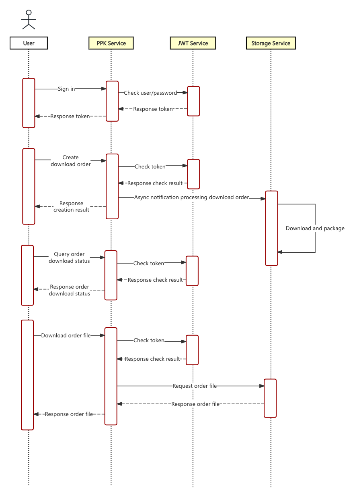

# PPK Api List

## Table of Contents


- [Introduction](#document)
- [Quick Start](#quick-start)
- [Overview](#overview)
- 1 User API
  - [1.1 Sign in account](#signin)
  - [1.2 User Info](#user-info)

- 2 Download API
  - [2.1 Get the nearest stations](#nearest-stations)
  - [2.2 Create Download Order](#create-download-order)
  - [2.3 Create NRCAN results file download order](#create-nrcan-order)
  - [2.4 Get download order status](#order-status)
  - [2.5 Download](#download-file)
  - [2.6 Get station epoch ratio](#station-epoch-ratio)

- 3 Base stations
  - [3.1 Get all stations](#station-list)
  - [3.2 Get station information](#station-info)

- Appendix
  - [Status code list](#status-code-list)


---


<a id="document"></a>

## Introduction

### Post-Processed Centimeter Accuracy from Historical Data

Not every workflow needs corrections in real time. **Post-Processed Kinematic (PPK)** uses the same underlying math as RTK, but applies corrections *after* the data is collected — typically once you're back at the office. This is the standard approach for drone mapping, remote-area work where cellular coverage is unreliable, and any application where data integrity matters more than real-time feedback.


GEODNET's PPK Service provides on-demand access to **historical RTCM observation data** from any base station in the network. You download the time range you need, convert it to RINEX format using free tools like RTKLIB or commercial software, and use it as the reference for post-processing your rover data.


**Best for:** drone mapping (Pix4D, Metashape, WingtraHub workflows), survey-grade aerial photogrammetry, drone LiDAR, remote-area surveying without cellular coverage, archival and legal-record work where you want to verify a measurement after the fact, and scientific applications where the highest possible accuracy is needed.


For a deeper explanation of RTK vs. PPK and when to choose which, see the **Knowledge Center, Section 2.6**.


### How to obtain an account

Please submit your application to <a href="mailto:support@geodnet.com">support@geodnet.com</a>, and we will provide your account information as soon as possible.


> [!TIP]
> The account system in PPK Service is independent and cannot be used interchangeably with other services.


---

<a id="quick-start"></a>

## Quick Start (End-to-end cURL)




### Prerequisites

- `curl` and `jq` are installed.
- You have a valid GEODNET PPK `username` and `password`.
- Examples use Bash syntax; adjust for PowerShell as needed.


### (1) Sign in to obtain token


```
TOKEN=$(curl -s -X POST "https://ppk.geodnet.com/api/user/signin" \
  -H "Content-Type: application/json" \
  -d '{"username":"geoduser","password":"geodpass"}' | jq -r '.data.token')
```


### (2) Create download order


```
ORDER=$(curl -s -X POST "https://ppk.geodnet.com/api/user/download" \
  -H "Content-Type: application/json" \
  -H "token: $TOKEN" \
  -d '{"startYear":2024,"startMonth":6,"startDay":22,"startHour":0,"endYear":2024,"endMonth":6,"endDay":23,"endHour":0,"stations":["G001"],"type":2}' \
  | jq -r '.data.orderId')
```


> [!NOTE]
> Steps are identical for NRCAN results, except step 2 uses `/api/user/estimation/download` with `startDate`, `endDate`, `station`.


### (3) Poll status until completed


```
while true; do
  STATUS=$(curl -s "https://ppk.geodnet.com/api/download/status/$ORDER" -H "token: $TOKEN" | jq -r '.data.status')
  if [ "$STATUS" = "2" ]; then
    echo "Completed"
    break
  elif [ "$STATUS" = "3" ]; then
    echo "Failed"
    exit 1
  else
    echo "Processing..."
    sleep 5
  fi
done
```


Status values: 1 = Processing, 2 = Completed, 3 = Failed.


### (4) Download file


```
curl -L "https://ppk.geodnet.com/api/download/$ORDER" -H "token: $TOKEN" -o "geodnet_${ORDER}.zip"
```


### (5) Convert to RINEX

Download the open-source convert tool: <a href="https://github.com/geodnet/rtklib_lte" target="_blank" rel="noopener">rtklib_lte</a>. The Windows binary includes `convbin.exe`; build the project for Linux or macOS.


> [!NOTE]
> year, mon, day, hour, min, sec are the approximate time of the RTCM log file, not the time you download the file.
use `-v 2.11` to output RINEX 2.11 legacy version.


```
convbin.exe -r rtcm3 -tr year/mon/day hour:min:sec unziped_rtcm_file
```


---

<a id="overview"></a>

## Overview

### Overview

This document is mainly intended for customers who need to obtain historical RTCM raw data. Customers can use the API we provide to download the required RTCM raw data.


### GEODNET PPK API

API for obtaining historical RTCM raw data, NRCAN results, and station metadata.


### API Usage Flow

1. Sign in to obtain token.
2. (Optional) Query nearest stations or station info.
3. Create a download order with time range and station list.
4. Poll the order status until Completed.
5. Download the resulting file using the orderId.
6. Convert RTCM to RINEX via RTKLIB convbin.


> [!IMPORTANT]
> In PPK, the account system is independent. Please make sure you have obtained a username and password from GEODNET before use.

### HTTP request


| Parameter | Example |
| :--- | :--- |
| Base URL | https://ppk.geodnet.com |
| Methods | GET / POST |
| Content-Type | application/json unless otherwise noted |
| Auth | Request header: token: <JWT> |


### HTTP response


| Parameter | Example | Type | Description |
| :--- | :--- | :--- | :--- |
| code | 200 | Number | Status code |
| message | Success | String | Status code description |
| data | {} | Object | Data content |


---

<a id="signin"></a>

## 1.1 User API — Sign in account


| | |
|---|---|
| URL | https://ppk.geodnet.com/api/user/signin |
| Method | POST |

### Request Body


| Parameter | Example | Type | Required | Description |
| :--- | :--- | :--- | :--- | :--- |
| username | geoduser | String | Yes | Username |
| password | geodpass | String | Yes | Password |


### cURL


```
curl -X POST "https://ppk.geodnet.com/api/user/signin"
  -H "Content-Type: application/json"
  -d '{"username":"geoduser","password":"geodpass"}'
```


### Request Example


```
{
  "username": "geoduser",
  "password": "geodpass"
}
```


### Response


```
{
  "code": 200,
  "message": "Success",
  "data": {
    "token": "eyJhbGciOiJIUzI1NiIsInR5cCI6IkpXVCJ9..."
  }
}
```


> [!IMPORTANT]
> The token generated at each login is valid for seven days.


---

<a id="user-info"></a>

## 1.2 User API — Get user information


| | |
|---|---|
| URL | https://ppk.geodnet.com/api/user/info |
| Method | GET |

### Request Header


| Header | Example | Type | Required | Description |
| :--- | :--- | :--- | :--- | :--- |
| token | eyJhbGciOiJIUzI1Ni... | String | Yes | JWT from sign in |


### Response Body


| Parameter | Example | Type | Description |
| :--- | :--- | :--- | :--- |
| code | 200 | Number | Status code |
| message | Success | String | Status code description |
| data.username | geoduser | String | Username |
| data.email | geoduser@gmail.com | String | Email |
| data.createTime | 1719388451655 | Number | Registration time ms |
| data.balance | 100 | Number | Balance |
| data.expense | 0 | Number | Expense |


### cURL


```
curl -X GET "https://ppk.geodnet.com/api/user/info" \
  -H "token: eyJhbGciOiJIUzI1Ni..."
```


### Response


```
{
  "code": 200,
  "message": "Success",
  "data": {
    "username": "geoduser",
    "email": "geoduser@gmail.com",
    "createTime": 1719388451655,
    "balance": 100,
    "expense": 0
  }
}
```


---

<a id="create-download-order"></a>

## 2.1 Download API — Create download order


| | |
|---|---|
| URL | https://ppk.geodnet.com/api/user/download |
| Method | POST |

### Request Body


| Parameter | Example | Type | Required | Description |
| :--- | :--- | :--- | :--- | :--- |
| startYear | 2024 | Number | Yes | Year start |
| startMonth | 6 | Number | Yes | Month start |
| startDay | 22 | Number | Yes | Day start |
| startHour | 0 | Number | Yes | Hour start |
| endYear | 2024 | Number | Yes | Year end |
| endMonth | 6 | Number | Yes | Month end |
| endDay | 23 | Number | Yes | Day end |
| endHour | 0 | Number | Yes | Hour end |
| stations | ["G001"] | Array | Yes | Station list |
| type | 2 | Number | No | Default All; 1: All, 2: 30 second |
| fileType | 0 | Number | No | Default RTCM; 0: `RTCM`, 1: `RINEX 3.04`, 2: `RINEX 2.11` |


> [!IMPORTANT]
> When downloading the RINEX file, only one site can be downloaded per request, and cross-day downloading is not allowed.


### Response Body


| Parameter | Example | Type | Description |
| :--- | :--- | :--- | :--- |
| code | 200 | Number | Status code |
| message | Success | String | Status code description |
| data.orderId | 667bebbe9f32c8ef2dd4643f | String | Order No. |


### Request Example


```
{
  "startYear": 2024,
  "startMonth": 6,
  "startDay": 22,
  "startHour": 0,
  "endYear": 2024,
  "endMonth": 6,
  "endDay": 23,
  "endHour": 0,
  "stations": ["G001"],
  "type": 2,
  "fileType": 0
}
```


### cURL


```
curl -X POST "https://ppk.geodnet.com/api/user/download" \
  -H "Content-Type: application/json" \
  -H "token: eyJhbGciOiJIUzI1Ni..." \
  -d '{
    "startYear": 2024,
    "startMonth": 6,
    "startDay": 22,
    "startHour": 0,
    "endYear": 2024,
    "endMonth": 6,
    "endDay": 23,
    "endHour": 0,
    "stations": ["G001"],
    "type": 2,
    "fileType": 0
  }'
```


### Response


```
{
  "code": 200,
  "message": "Success",
  "data": {
    "orderId": "667bebbe9f32c8ef2dd4643f"
  }
}
```


---

<a id="nearest-stations"></a>

## 2.2 Download API — Get the nearest stations


| | |
|---|---|
| URL | https://ppk.geodnet.com/api/user/station |
| Method | GET |

### Query Params


| Parameter | Example | Type | Required | Description |
| :--- | :--- | :--- | :--- | :--- |
| longitude | 10 | String | Yes | Longitude decimal degrees |
| latitude | 20 | String | Yes | Latitude decimal degrees |
| year | 2024 | String | No | UTC year for data availability |
| month | 6 | String | No | UTC month |
| day | 22 | String | No | UTC day |
| hour | 0 | String | No | UTC hour |


> [!CAUTION]
> If year/month/day/hour provided, stations are filtered by data availability at that UTC time.


### Request Header


| Header | Example | Type | Required | Description |
| :--- | :--- | :--- | :--- | :--- |
| token | eyJhbGciOiJIUzI1Ni... | String | Yes | JWT from sign in |


### Response Body


| Parameter | Example | Type | Description |
| :--- | :--- | :--- | :--- |
| code | 200 | Number | Status code |
| message | Success | String | Status code description |
| data.stations | [...] | Array | Station list; empty if none matches |
| data.stations[].name | G001 | String | Station name |
| data.stations[].distance | 10.23 | Number | Distance in km |


### Request Example


```
https://ppk.geodnet.com/api/user/station?longitude=10&latitude=20
```


### cURL


```
curl -G "https://ppk.geodnet.com/api/user/station" \
  -H "token: eyJhbGciOiJIUzI1Ni..." \
  --data-urlencode "longitude=10" \
  --data-urlencode "latitude=20"
```


### Response


```
{
  "code": 200,
  "message": "Success",
  "data": {
    "stations": [
      { "name": "G001", "distance": 10.23 },
      { "name": "G002", "distance": 60.11 }
    ]
  }
}
```


---

<a id="create-nrcan-order"></a>

## 2.3 Download API — Create NRCAN results file download order


| | |
|---|---|
| URL | https://ppk.geodnet.com/api/user/estimation/download |
| Method | POST |

### Request Body


| Parameter | Example | Type | Required | Description |
| :--- | :--- | :--- | :--- | :--- |
| startDate | 2025-06-01 | Date | Yes | YYYY-MM-DD |
| endDate | 2025-06-26 | Date | Yes | YYYY-MM-DD format. Maximum 30 days from startDate |
| station | G001 | String | Yes | Base station name |
|  |  |  |  |  |


> [!CAUTION]
> The time range (endDate − startDate) cannot exceed 30 days.


### Response Body


| Parameter | Example | Type | Description |
| :--- | :--- | :--- | :--- |
| code | 200 | Number | Status code |
| message | Success | String | Status code description |
| data.orderId | 685e5f63069bfe72e44d17fb | String | Order No. |


### Request Example


```
{
  "station": "G001",
  "startDate": "2025-06-01",
  "endDate": "2025-06-26"
}
```


### cURL


```
curl -X POST "https://ppk.geodnet.com/api/user/estimation/download" \
  -H "Content-Type: application/json" \
  -H "token: eyJhbGciOiJIUzI1Ni..." \
  -d '{"station":"G001","startDate":"2025-06-01","endDate":"2025-06-26"}'
```


### Response


```
{
  "code": 200,
  "message": "Success",
  "data": {
    "orderId": "685e5f63069bfe72e44d17fb"
  }
}
```


### Tip


```
Archive contains multiple files; NRCAN outputs of interest:
- xxxx.pdf
- xxxx.sum
- errors.txt
```


---

<a id="order-status"></a>

## 2.4 Download API — Get download order status


| | |
|---|---|
| URL | https://ppk.geodnet.com/api/download/status/:orderId |
| Method | GET |

### Path Param


| Parameter | Example | Type | Required | Description |
| :--- | :--- | :--- | :--- | :--- |
| orderId | 685e5f63069bfe72e44d17fb | String | Yes | Order No. |


### Request Header


| Header | Example | Type | Required | Description |
| :--- | :--- | :--- | :--- | :--- |
| token | eyJhbGciOiJIUzI1Ni... | String | Yes | JWT from sign in |


### Response Body


| Parameter | Example | Type | Description |
| :--- | :--- | :--- | :--- |
| code | 200 | Number | Status code |
| message | Success | String | Status code description |
| data.status | 2 | Number | 1: Processing; 2: Completed; 3: Failed |


### Request Example


```
https://ppk.geodnet.com/api/download/status/685e5f63069bfe72e44d17fb
```


### cURL


```
curl -X GET "https://ppk.geodnet.com/api/download/status/685e5f63069bfe72e44d17fb" \
  -H "token: eyJhbGciOiJIUzI1Ni..."
```


### Response


```
{
  "code": 200,
  "message": "Success",
  "data": {
    "status": 2
  }
}
/*
Order status:
1: Processing
2: Completed
3: Failed
*/
```


---

<a id="download-file"></a>

## 2.5 Download API — Download


| | |
|---|---|
| URL | https://ppk.geodnet.com/api/download/:orderId |
| Method | GET |

### Path Param


| Parameter | Example | Type | Required | Description |
| :--- | :--- | :--- | :--- | :--- |
| orderId | 685e5f63069bfe72e44d17fb | String | Yes | Order No. |


### Request Header


| Header | Example | Type | Required | Description |
| :--- | :--- | :--- | :--- | :--- |
| token | eyJhbGciOiJIUzI1Ni... | String | Yes | JWT from sign in |


### Response Body

When request is abnormal, for example invalid `orderId` or not completed, a JSON is returned:


| Parameter | Example | Type | Description |
| :--- | :--- | :--- | :--- |
| code | 304 | Number | Error code, see status code list |
| message | The download task has not been completed | String | Error description |


**Normal success:** returns a ZIP file stream, no JSON body.


### Request Example


```
https://ppk.geodnet.com/api/download/685e5f63069bfe72e44d17fb
```


### cURL


```
curl -L "https://ppk.geodnet.com/api/download/685e5f63069bfe72e44d17fb" \
  -H "token: eyJhbGciOiJIUzI1Ni..." \
  -o "geodnet_685e5f63069bfe72e44d17fb.zip"
```


### Response

If parameters are valid and the order is completed, the response is a ZIP file stream.


If the request is abnormal, for example invalid orderId or not completed, the response is JSON with error code/message.


---

<a id="station-list"></a>

## 3.1 Base stations — Get all stations


| | |
|---|---|
| URL | https://ppk.geodnet.com/api/user/station/list |
| Method | GET |

### Request Header


| Header | Example | Type | Required | Description |
| :--- | :--- | :--- | :--- | :--- |
| token | eyJhbGciOiJIUzI1Ni... | String | Yes | JWT from sign in |


### Response Body


| Parameter | Example | Type | Description |
| :--- | :--- | :--- | :--- |
| code | 200 | Number | Status code |
| message | Success | String | Status code description |
| data.stations | [...] | Array | Station list |
| data.stations[].name | G001 | String | Station name |
| data.stations[].status | ACTIVE | String | ONLINE/ACTIVE/OFFLINE |
| data.stations[].coordinate | {...} | Object | Coordinate info Deprecated |
| data.stations[].coordinate.ITRF2020 | [-2687303.0592,-4302926.7171,3852731.263] | Array | [x,y,z] ITRF2020 |
| data.stations[].coordinate.ITRF2020(2015) | [...] | Array | [x,y,z] ITRF2020(2015) |
| data.stations[].coordinate.WGS84 | [...] | Array | [x,y,z] WGS84 |
| data.stations[].coordinate.local | [...] | Array | [x,y,z] Local |
| data.stations[].nrcan | Object | Object | NRCAN precision info (no coordinate) |
| data.stations[].nrcan.epoch | 2024.36 | Number | Epoch |
| data.stations[].nrcan.sigma95X | 0 | Number | 95% confidence sigma of X |
| data.stations[].nrcan.sigma95Y | 0 | Number | 95% confidence sigma of Y |
| data.stations[].nrcan.sigma95Z | 0 | Number | 95% confidence sigma of Z |
| data.stations[].highPrecision | [...] | Array | High precision coordinate list |
| data.stations[].highPrecision[].name | ITRF2020(2025.50) | String | Coordinate system |
| data.stations[].highPrecision[].epoch | 2025.5 | Number | Epoch |
| data.stations[].highPrecision[].x | -2687303.0592 | Number | X |
| data.stations[].highPrecision[].y | -4302926.7171 | Number | Y |
| data.stations[].highPrecision[].z | 3852731.263 | Number | Z |


> [!CAUTION]
> If x, y, z is 0, the coordinates are invalid.


### cURL


```
curl -X GET "https://ppk.geodnet.com/api/user/station/list" \
  -H "token: eyJhbGciOiJIUzI1Ni..."
```


### Response


```
{
  "code": 200,
  "message": "Success",
  "data": {
    "stations": [
      {
        "name": "G001",
        "status": "ACTIVE",
        "coordinate": {
          "ITRF2020": [-2687303.0592, -4302926.7171, 3852731.263],
          "ITRF2020(2015)": [-2687302.8158, -4302926.9653, 3852731.1618],
          "WGS84": [-2687303.0595, -4302926.7172, 3852731.2649],
          "local": [-2687301.916, -4302928.3503, 3852731.1364]
        },
        "nrcan": {
          "epoch": 2025.5,
          "sigma95X": 0.0044,
          "sigma95Y": 0.0066,
          "sigma95Z": 0.0057
        }
        "highPrecision": [
          {
            "name": "ITRF2020(2025.50)",
            "epoch": 2025.5,
            "x": -2687303.0592,
            "y": -4302926.7171,
            "z": 3852731.263
          },
          {
            "name": "ITRF2020(2015.00)",
            "epoch": 2015,
            "x": -2687302.8158,
            "y": -4302926.9653,
            "z": 3852731.1618
          },
          {
            "name": "WGS84(G2139)(2025.50)",
            "epoch": 2025.5,
            "x": -2687303.0595,
            "y": -4302926.7172,
            "z": 3852731.2649
          },
          {
            "name": "NAD83(2011)(2010.00)",
            "epoch": 2010,
            "x": -2687301.916,
            "y": -4302928.3503,
            "z": 3852731.1364
          }
        ]
      }
    ]
  }
}
```


---

<a id="station-info"></a>

## 3.2 Base stations — Get station information


| | |
|---|---|
| URL | https://ppk.geodnet.com/api/user/station/:name |
| Method | GET |

### Path Param


| Parameter | Example | Type | Required | Description |
| :--- | :--- | :--- | :--- | :--- |
| name | G001 | String | Yes | Station name |


### Request Header


| Header | Example | Type | Required | Description |
| :--- | :--- | :--- | :--- | :--- |
| token | eyJhbGciOiJIUzI1Ni... | String | Yes | JWT from sign in |


### Response Body


| Parameter | Example | Type | Description |
| :--- | :--- | :--- | :--- |
| code | 200 | Number | Status code |
| message | Success | String | Status code description |
| data.name | G001 | String | Station name |
| data.status | ACTIVE | String | ONLINE/ACTIVE/OFFLINE |
| data.coordinate | {...} | Object | Coordinate info Deprecated |
| data.coordinate.ITRF2020 | [-2687303.0592,-4302926.7171,3852731.263] | Array | [x,y,z] ITRF2020 |
| data.coordinate.ITRF2020(2015) | [...] | Array | [x,y,z] ITRF2020(2015) |
| data.coordinate.WGS84 | [...] | Array | [x,y,z] WGS84 |
| data.coordinate.local | [...] | Array | [x,y,z] Local |
| data.highPrecision | [...] | Array | High precision coordinate list |
| data.highPrecision[].name | ITRF2020(2025.50) | String | Coordinate system |
| data.highPrecision[].epoch | 2025.5 | Number | Epoch |
| data.highPrecision[].x | -2687303.0592 | Number | X |
| data.highPrecision[].y | -4302926.7171 | Number | Y |
| data.highPrecision[].z | 3852731.263 | Number | Z |
| data.nrcan | {...} | Object | NRCAN precision info (no coordinate) |
| data.nrcan.epoch | 2025.5 | Number | Epoch |
| data.nrcan.sigma95X | 0.0044 | Number | 95% confidence sigma of X |
| data.nrcan.sigma95Y | 0.0066 | Number | 95% confidence sigma of Y |
| data.nrcan.sigma95Z | 0.0057 | Number | 95% confidence sigma of Z |


> [!CAUTION]
> If x, y, z is 0, the coordinates are invalid.


### Request Example


```
https://ppk.geodnet.com/api/user/station/G001
```


### cURL


```
curl -X GET "https://ppk.geodnet.com/api/user/station/G001" \
  -H "token: eyJhbGciOiJIUzI1Ni..."
```


### Response


```
{
  "code": 200,
  "message": "Success",
  "data": {
    "name": "G001",
    "status": "ACTIVE",
    "coordinate": {
      "ITRF2020": [-2687303.0592, -4302926.7171, 3852731.263],
      "ITRF2020(2015)": [-2687302.8158, -4302926.9653, 3852731.1618],
      "WGS84": [-2687303.0595, -4302926.7172, 3852731.2649],
      "local": [-2687301.916, -4302928.3503, 3852731.1364]
    },
    "highPrecision": [
      {
        "name": "ITRF2020(2025.50)",
        "epoch": 2025.5,
        "x": -2687303.0592,
        "y": -4302926.7171,
        "z": 3852731.263
      },
      {
        "name": "ITRF2020(2015.00)",
        "epoch": 2015,
        "x": -2687302.8158,
        "y": -4302926.9653,
        "z": 3852731.1618
      },
      {
        "name": "WGS84(G2139)(2025.50)",
        "epoch": 2025.5,
        "x": -2687303.0595,
        "y": -4302926.7172,
        "z": 3852731.2649
      },
      {
        "name": "NAD83(2011)(2010.00)",
        "epoch": 2010,
        "x": -2687301.916,
        "y": -4302928.3503,
        "z": 3852731.1364
      }
    ],
    "nrcan": {
      "epoch": 2025.5,
      "sigma95X": 0.0044,
      "sigma95Y": 0.0066,
      "sigma95Z": 0.0057
    }
  }
}
```


---

<a id="status-code-list"></a>

## Appendix — Status code list

### Status code list


| Code | Description |
| :--- | :--- |
| 200 | Success |
| 201 | Request parameter error |
| 202 | Username does not exist |
| 203 | Password is incorrect |
| 204 | Invalid account |
| 205 | Token expired |
| 206 | Account has expired |
| 301 | Incomplete date information |
| 302 | Invalid date parameter |
| 303 | Insufficient balance |
| 304 | The download task has not been completed |
| 305 | The download task has failed |
| 306 | The time period cannot exceed one month |
| 307 | Invalid stations or no data found during the period |
| 308 | Download RINEX files; a single request can only process one station. |
| 309 | Download RINEX files; cross-day requests are not allowed. |
| 310 | Station QC quality is poor. Download failed. |
| 321 | The end time must be greater than the start time |
| 322 | The start and end time must be within the same UTC day |
| 501 | Request exception |


### Response examples


```
// Success
{
  "code": 200,
  "message": "Success"
}

// Not completed
{
  "code": 304,
  "message": "The download task has not been completed"
}

// Parameter error
{
  "code": 201,
  "message": "Request parameter error"
}
```


---

<a id="station-epoch-ratio"></a>

## 2.6 PPK Check — Get station epoch ratio and MP12


| | |
|---|---|
| URL | https://ppk.geodnet.com/api/user/check/station/epoch-ratio |
| Method | POST |

### Request Header


| Header | Example | Type | Required | Description |
| :--- | :--- | :--- | :--- | :--- |
| Content-Type | application/json | String | Yes | Request body format. |


### Request Body


| Parameter | Example | Type | Required | Description |
| :--- | :--- | :--- | :--- | :--- |
| station | BJFS | String | Yes | Station name. Leading and trailing spaces are trimmed. Cannot be empty. |
| start | 1735689600000 | Number | Yes | Start timestamp in milliseconds, inclusive (>=). Must be a non-negative integer. |
| end | 1735776000000 | Number | Yes | End timestamp in milliseconds, exclusive (<). Must be an integer greater than start. The query interval [start, end) must not span multiple UTC days. |


> [!CAUTION]
> - `start` and `end` should be aligned to the hour. Each QC record represents one hour, and a range shorter than one hour is counted as one hour.
- `start` and `end` must fall within the same UTC day. Cross-day queries are not supported. To query multiple days, send one request per UTC day.


### Response Body


| Parameter | Example | Type | Description |
| :--- | :--- | :--- | :--- |
| code | 0 | Number | Business status code. 0 indicates success; 1002 indicates invalid request parameters. |
| msg | OK | String | Status description. |
| data | {...} | Object | Result object. Returned on success. |
| data.station | BJFS | String | Station name after trimming leading and trailing spaces. |
| data.start | 1735689600000 | Number | Start timestamp in milliseconds, inclusive. |
| data.end | 1735776000000 | Number | End timestamp in milliseconds, exclusive. |
| data.ratio | 95.49 | Number | Epoch completeness percentage, rounded to 2 decimal places. 95.49 means 95.49%. The minimum required completeness is 90%. |
| data.mp12 | 0.72 | Number | null | Arithmetic mean of numeric mp.MP12 values, rounded to 4 decimal places. Null when no numeric MP12 values are available. The maximum allowed average is 0.7. |
| data.qualified | false | Boolean | Whether the station data meets all QC requirements. True requires epoch completeness >= 90%, at least one returned QC record, a numeric MP12 value in every returned record, and MP12 average <= 0.7. |


> [!CONDITIONS THAT PREVENT USE]
> Station data is not allowed for use (`qualified: false`) when any of the following conditions is met:

- The unrounded epoch completeness percentage is below 90%.
- The unrounded MP12 average is greater than 0.7.
- No QC records are returned for the query interval.
- Any returned QC record has a missing or non-numeric MP12 value.

### cURL


```
curl -X POST "https://ppk.geodnet.com/api/user/check/station/epoch-ratio" \
  -H "Content-Type: application/json" \
  -d '{
    "station": "BJFS",
    "start": 1735689600000,
    "end": 1735776000000
  }'
```


### Response — Qualified


```
{
  "code": 0,
  "msg": "OK",
  "data": {
    "station": "BJFS",
    "start": 1735689600000,
    "end": 1735776000000,
    "ratio": 95.49,
    "mp12": 0.65,
    "qualified": true
  }
}
```


### Response — MP12 average exceeds the limit


```
{
  "code": 0,
  "msg": "OK",
  "data": {
    "station": "BJFS",
    "start": 1735689600000,
    "end": 1735776000000,
    "ratio": 95.49,
    "mp12": 0.72,
    "qualified": false
  }
}
```


---

