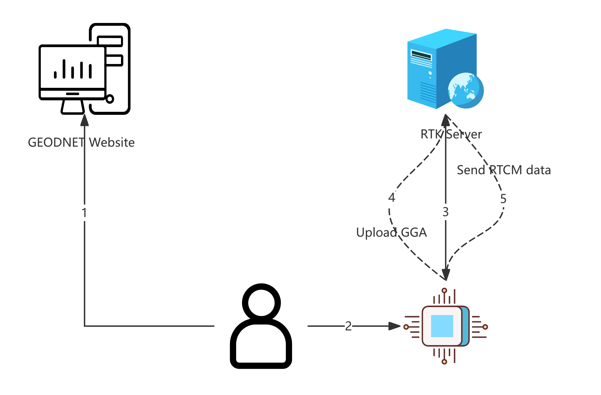

# GEODNET RTK API

## Table of Contents


- [INTRODUCTION](#document)
- Quick Start
  - [Quick Start](#quick-start)
  - Third-Party Apps
    - [Topcon](#topcon)


- [Overview](#overview)
- 1 User Management
  - [1.1 Create account](#user-create)
  - [1.2 Query account](#user-info)
  - [1.3 Query user list](#user-list)
  - [1.4 Update expiration time](#user-set-expiration)
  - [1.5 Update password](#user-set-password)
  - [1.6 Update status](#user-set-status)
  - [1.7 Update connections](#user-set-connections)
  - [1.8 Update email](#user-set-email)
  - [1.9 Query change logs](#user-logs)
  - [1.10 Query rtk logs](#user-rtk-logs)
  - [1.11 Create random account](#create-random-account)
  - [1.12 Query subscription info](#subscription-query)
  - [1.13 Report subscription info](#subscription-report)

- 2 Base Station
  - [2.1 Query coverage](#coverage-list)
  - [2.2 Query quality](#coverage-quality)
  - [2.3 Get station list](#station-list)
  - [2.4 Get station info](#station-info)


- [6.1 Sign in account](#6-1-personal-user-login)
- [6.2 Query RTK history](#6-2-personal-user-rtk-logs)

- Appendix
  - [Status code list](#status-code-list)


---


<a id="document"></a>

## Introduction

### Real-Time Centimeter-Level Positioning

GEODNET's RTK service delivers real-time corrections that take a standard GNSS receiver from meter-level accuracy to **1–2 centimeters**. Connect your rover to our network over the internet, and corrections start flowing immediately — no base station to install, no UHF radios to license, no hardware lock-in.


The service runs over standard **NTRIP** with corrections in **RTCM 3.2** format, so it works with essentially any **RTK-capable** receiver: u-blox ZED-F9P, Quectel, Septentrio, Trimble, Hemisphere, Topcon, Leica, and others. Every base station in the network is a triple-band, full-constellation receiver with an NGS-calibrated antenna, with ~20,000+ stations across 150+ countries and 24/7 monitoring.


**Best for:** surveying, construction stake-out, machine control, precision agriculture, robotics, drone mapping, autonomous vehicles, AR/VR, and any application where centimeter accuracy matters in real time.


To get started, you'll need an active GEODNET account, an **RTK-capable** receiver with an NTRIP client, and cellular or Wi-Fi internet. The connection details below cover the regional servers, ports, and mountpoints — point your receiver at the closest server, enter your account credentials, and you'll typically see an RTK Fix within 5–30 seconds in open sky.


New to RTK or NTRIP, or want a deeper explanation of how the corrections actually work? See the **Knowledge Center, Sections 1–3**, for full background on GNSS, RTK, and NTRIP setup.


### How to select a mountpoint

Currently, GEODNET RTK service is based on Nearest-base RTK service. GEODNET provides several mountpoints (AUTO, AUTO_ITRF2020, AUTO_ITRF2014, AUTO_WGS84).


| # | Mountpoint | Details |
| :--- | :--- | :--- |
| 1 | AUTO | Regional Geodetic Coordinate System (RGCS) |
| 2 | AUTO_ITRF2020 | ITRF2020 Geodetic Coordinate System at current epoch |
| 3 | AUTO_ITRF2014 | ITRF2014 Geodetic Coordinate System at current epoch |
| 4 | AUTO_WGS84 | WGS84(G2139) in the middle of the current year (for example, 2025.5 for year 2025, 2024.5 for year 2024) |
| 5 | BRDC | Global Ephemeris Data |
| 6 | NATRF2020 | Test RTK service for NTRAF2020 coordinate frame (only in NA) |
| 7 | SIRGAS2000(2026.5) | Test RTK service for SIRGAS2000 coordinate frame in the middle of the current year (only in SA) |


Regional Geodetic Coordinate System


| # | Geodetic Coordinate System Name | Epoch # | Effective regions |
| :--- | :--- | :--- | :--- |
| 1 | NAD83(2011) | 2010.0 | USA and North America |
| 2 | NAD83(PA11) | 2010.0 | USA Hawaii |
| 3 | NAD83(MA11) | 2010.0 | GUM |
| 4 | NAD83(CSRS)v7 | 2010.0 | CAN |
| 5 | ETRS89(ETRF2000)(2010.0) | 2010.0 | Europe |
| 6 | GDA2020(2020.0) | 2020.0 | AUS |
| 7 | NZGD2000(2000.0) | 2000.0 | NZL |
| 8 | TUREF(2005.0)=ITRF96(2005.0) | 2005.0 | TUR |
| 9 | ITRF2008(2005.0)=ITRF2008(2005.0) | 2005.0 | IND |
| 11 | ITRF2008(2011.811) | 2011.811 | EGY |
| 12 | NGD2012(2012.0)=ITRF2008(2012.0) | 2012.0 | NGA |
| 13 | PGD2020=ITRF2014(2020.044) | 2020.044 | PHL |
| 14 | ITRF2014(2010) | 2010.0 | MEX |
| 15 | ITRF2014 | current epoch | Current KEN |
| 16 | CGCS2000(2000.0)=ITRF97(2000.0)<sup>2</sup> | 2000.0 | CHN |
| 17 | JGD2011(2011.3945)=ITRF2008(2011.3945) | 2011.3945 | JPN |
| 18 | IGRS2013(2012.0)=ITRF2008(2012.0) | 2012.0 | IDN |
| 19 | ITRF1991(1994.0) | 1994.0 | ZAF |
| 20 | WGS84(G730)(1994.0) | 1994.0 | LKA |
| 21 | ITRF2020(2025.0) | 2025.0 | TWN |
| 22 | ITRF2014(2010) | 2010.0 | THA |
| 23 | KGD2002(2002.0)=ITRF2000(2002.0) | 2002.0 | KOR |
| 24 | MGRF2020(2020.0)=ITRF2020(2020.0) | 2020.0 | MYS |
| 25 | MTRF2000(2004.0)=ITRF2000(2004.0) | 2004.0 | ARE |
| 26 | SIRGAS2000(2000.4)=ITRF2000(2000.4) | 2000.4 | South America |
| 27 | GGD=ITRF2008(2011.353) | 2011.353 | GEO |
| 28 | WGS84(G2139)(20xx.5)<sup>1</sup> | 20xx.5 | Other regions |


<sup>1</sup> The WGS84 is used in AUTO_WGS84, since WGS84 is a global dynamic coordinate system, where the coordinate of the station will change due to the global plate tectonics movement. The WGS84(G2139)(20xx.50) with the middle of current year is adapted to best match the current GPS real-time orbit based on NGS recommendations.
<sup>2</sup> GEODNET does not provide RTK service in this region now, can broadcast partnerships' RTK/VRS service in this region based on user requests.


### NMEA GGA Position upload

> [!IMPORTANT]
> It is very important to upload the NMEA GGA position from the RTK device to GEODNET server, otherwise, there will be no RTK corrections received in the device.


### How to connect to the RTK Server

Currently all GEODNET services are based on AWS E2C services.


| Area | Domain | IPv4 | Port |
| :--- | :--- | :--- | :--- |
| USA | rtk.geodnet.com | 13.56.117.10 | 2101 |
| Europe | eu.geodnet.com | 3.73.41.96 | 2101 |
| AUS | aus.geodnet.com | 54.206.56.130 | 2101 |
| South America | sa.geodnet.com | 18.230.73.64 | 2101 |
| India | ind.geodnet.com | 13.203.34.145 | 2101 |


### How to obtain an account

Submit an application to GEODNET's official site, and GEODNET will respond as soon as possible.


[Free RTK Trial](https://geodnet.com/free-rtk-trial)


### How to access the User Center

In the User Center, you can view the historical usage records of the RTK service, and you can also purchase service time for your account. Please click the button below to enter the User Center.


[User Portal](https://rtk.geodnet.com/user)


### How to access the Enterprise Management Platform

If you are an RTK service distributor and have completed GEODNET authorization, you will receive access to the Enterprise Management Platform. Using your access credentials, you can manage your RTK customers and perform daily maintenance tasks. Please click the button below to enter the Enterprise Management Platform.


[Enterprise](https://rtk.geodnet.com/enterprise/login)


---

<a id="quick-start"></a>

## Quick Start



1. **Submit a free trial request to GEODNET, and GEODNET will send you the account information.**
2. **After obtaining the RTK account, configure the account information in your Rover.**
3. **After configuring the GEODNET account and the appropriate mountpoint in the Rover, communication with the GEODNET RTK Server is established via the NTRIP protocol.**
4. **The Rover actively uploads NMEA GGA data.**
5. **Based on the uploaded GGA data, the RTK Server determines the most suitable reference station and delivers RTCM corrections in real time.**

### How to use RTKLIB


### How to use SW Maps


---

<a id="topcon"></a>

## Topcon

### Topcon MAGNET NTRIP Settings

This document provides step-by-step instructions for configuring Topcon MAGNET NTRIP settings with GEODNET RTK.


If you have any questions, please contact support@geodnet.com.


1. **From the Home Screen click Configuration.**
2. **Label the connection GEODNET. Enter the IP address and port number. Use your NTRIP username and password provided by our GEODNET team, or from the GEODNET RTK resellers. Click the green checkmark.**
3. **Check 'Automatic Rover Pos' this step will send the GGA message to the RTN server when you log in.**
4. **Click Next. **The next 9 screens are to be setup according to your preferences.****
5. **On the Tracking screen check on the constellations that are available according to your equipment.**
6. **Click Next through the last windows or click the green checkmark in the top right corner to finish the set up.**
7. **From the Home screen click Connect.**
8. **Select the mount point from the list.**


---

<a id="overview"></a>

## Overview

### Overview

This document defines APIs of the GEODNET RTK service, including *User Management* and *Base Station Coverage*.


> [!NOTE]
> All APIs use a request `sign` generated from request parameters and your secret `appKey`. Responses use a business envelope with `{ code, msg, data }`.


### Log Data Retention

All log-related data (e.g. session logs, login logs) referenced throughout this document follows a unified retention policy unless otherwise specified in a specific API's parameters.


> [!NOTE]
> Log data is retained for the most recent **6 months** by default. Queries for data older than 6 months will not return results. Please plan your data capture, export, or archival frequency accordingly.


### Encryption parameter


| Parameter | Type | Description |
| :--- | :--- | :--- |
| `appId` | String | Application ID |
| `appKey` | String | Application Key |


> [!NOTE]
> `appId` and `appKey` uniquely identify your tenant and are provided by GEODNET. Please request them from GEODNET.


### Encryption method

1. Sort the keys of **all request parameters** in ascending character order, **excluding** `appKey` and `sign`.
2. Concatenate the corresponding *values* by that key order to a single string.
3. Concatenate the string with `appKey` (append).
4. Compute MD5 hash of the final string to produce the `sign` value (hex lowercase).


```
# pseudo
ordered_keys = sort(keys(params - {sign}))
concat_values = ''.join(str(params[k]) for k in ordered_keys)
payload = concat_values + appKey
sign = md5_hex(payload)
```


> [!IMPORTANT]
> Do not include `appKey` or `sign` in the sorted parameter set. Ensure time values are milliseconds (Unix epoch ms) and MD5 output is lowercase hex.


### Encryption example

**Example parameter**


```
appId: geodnet
appKey: 2916350764adb542
```


**Request parameters**


| Parameter | Example | Type | Required | Description |
| :--- | :--- | :--- | :--- | :--- |
| `appId` | geodnet | String | Y | Application ID |
| `username` | geoduser | String | Y | username |
| `password` | geodpass | String | Y | password |
| `trialDays` | 7 | Number | Y | Free trial days |
| `time` | 1718150400000 | Number | Y | Current server timestamp in milliseconds |
| `sign` | 8dd687e158219da6ccc689aef6c0a6a1 | String | Y | Encrypted signature |


**Steps**


1. Parameter ordering (excluding `sign`)

```
appId, password, time, trialDays, username
```


2. Field value concatenation

```
geodnet + geodpass + 1718150400000 + 7 + geoduser
= "geodnetgeodpass17181504000007geoduser"
```


3. Concat with `appKey`

```
"geodnetgeodpass17181504000007geoduser" + "2916350764adb542"
= "geodnetgeodpass17181504000007geoduser2916350764adb542"
```


4. Generate `sign`

```
md5("geodnetgeodpass17181504000007geoduser2916350764adb542")
= 8dd687e158219da6ccc689aef6c0a6a1
```


### Implementation hints


```
//============= JavaScript (Node.js) example =============//
import crypto from "crypto";

function buildSign(params, appKey) {
  const keys = Object.keys(params).filter(k => k !== "sign").sort();
  const concat = keys.map(k => String(params[k])).join("") + appKey;
  return crypto.createHash("md5").update(concat).digest("hex");
}

const params = { appId: "geodnet", username: "geoduser", password: "geodpass", trialDays: 7, time: 1718150400000 };
const sign = buildSign(params, "2916350764adb542");

//============= Python example =============//
import hashlib

def build_sign(params: dict, app_key: str) -> str:
  keys = sorted(k for k in params.keys() if k != "sign")
  concat = "".join(str(params[k]) for k in keys) + app_key
  return hashlib.md5(concat.encode("utf-8")).hexdigest()

params = {"appId": "geodnet", "username": "geoduser", "password": "geodpass", "trialDays": 7, "time": 1718150400000}
sign = build_sign(params, "2916350764adb542")
```


---

<a id="user-create"></a>

## 1.1 User Management — Create account


| | |
|---|---|
| URL | https://rtk.geodnet.com/api/v3/user/create |
| Method | POST |

### Request Body


| Parameter | Example | Type | Required | Description |
| :--- | :--- | :--- | :--- | :--- |
| appId | geodnet | String | Yes | Application ID |
| username | geoduser | String | Yes | username |
| password | geodpass | String | Yes | password |
| email | user@geodnet.com | String | No | email |
| paymentType | 0 | Number | No | 0: Monthly; 1: Yearly |
| trialDays | 7 | Number | Yes | Free trial days, minimum value is 1 |
| time | 1718150400000 | Number | Yes | Current server timestamp in milliseconds |
| sign | 8dd687e158219da6ccc689aef6c0a6a1 | String | Yes | Encrypted signature |

> [!TIP]
> Please ensure that the username is unique within the GEODNET RTK ecosystem to avoid conflicts with the usernames of other enterprise customers.


### Response Body


| Parameter | Example | Type | Description |
| :--- | :--- | :--- | :--- |
| code | 1000 | Number | Status code |
| msg | OK | String | Status code description |


### cURL


```
curl -X POST "https://rtk.geodnet.com/api/v3/user/create" \
-H "Content-Type: application/json" \
-d '{
"appId": "geodnet",
"username": "geoduser",
"password": "geodpass",
"trialDays": 7,
"time": 1718150400000,
"sign": "8dd687e158219da6ccc689aef6c0a6a1"
}'
```


### Request Example


```
{
  "appId": "geodnet",
  "username": "geoduser",
  "password": "geodpass",
  "trialDays": 7,
  "time": 1718150400000,
  "sign": "8dd687e158219da6ccc689aef6c0a6a1"
}
```


### Response


```
{
  "code": 1000,
  "msg": "OK"
}
```


---

<a id="user-info"></a>

## 1.2 User Management — Query account


| | |
|---|---|
| URL | https://rtk.geodnet.com/api/v3/user/info |
| Method | POST |

### Request Body


| Parameter | Example | Type | Required | Description |
| :--- | :--- | :--- | :--- | :--- |
| appId | geodnet | String | Yes | Application ID |
| username | geoduser | String | Yes | username |
| time | 1718150400000 | Number | Yes | Current server timestamp in milliseconds |
| sign | 33fcd377ee04a81173f6d9b6e6f54ae3 | String | Yes | Encrypted signature |


### Response Body


| Parameter | Example | Type | Description |
| :--- | :--- | :--- | :--- |
| code | 1000 | Number | Status code |
| msg | OK | String | Status code description |
| data.username | geoduser | String | username |
| data.password | geodpass | String | password |
| data.email | user@geodnet.com | String | email |
| data.expiration | 1718792318595 | Number | account expiration timestamp in milliseconds |
| data.status | 0 | Number | 0: Enabled; 1: Disabled |
| data.connections | 1 | Number | Number of connections |
| data.paymentType | 0 | Number | 0: Monthly; 1: Yearly |


### cURL


```
curl -X POST "https://rtk.geodnet.com/api/v3/user/info" \
-H "Content-Type: application/json" \
-d '{
  "appId": "geodnet",
  "username": "geoduser",
  "time": 1718150400000,
  "sign": "33fcd377ee04a81173f6d9b6e6f54ae3"
}'
```


### Request Example


```
{
  "appId": "geodnet",
  "username": "geoduser",
  "time": 1718150400000,
  "sign": "33fcd377ee04a81173f6d9b6e6f54ae3"
}
```


### Response


```
{
  "code": 1000,
  "msg": "OK",
  "data": {
    "username": "geoduser",
    "password": "geodpass",
    "email": "",
    "expiration": 1718792318595,
    "status": 0,
    "connections": 1,
    "paymentType": 0
  }
}
```


---

<a id="user-list"></a>

## 1.3 User Management — Query user list


| | |
|---|---|
| URL | https://rtk.geodnet.com/api/v3/user/list |
| Method | POST |

### Request Body


| Parameter | Example | Type | Required | Description |
| :--- | :--- | :--- | :--- | :--- |
| appId | geodnet | String | Yes | Application ID |
| page | 1 | Number | Yes | Page |
| pageSize | 20 | Number | No | pageSize must be a multiple of 10 and not exceed 100, default: 20 |
| username | geodnet_ | String | No | Only prefix fuzzy queries or complete username queries are supported |
| time | 1718150400000 | Number | Yes | Current server timestamp (ms) |
| sign | 1526be641371c27c0e9c2857b636e6ab | String | Yes | Encrypted signature |

> [!TIP]
> The current query returns 20 items per page by default.


### Response Body


| Parameter | Example | Type | Description |
| :--- | :--- | :--- | :--- |
| code | 1000 | Number | Status code |
| msg | OK | String | Status code description |
| data | {...} | Object |  |
| data.total | 100 | Number | Total |
| data.page | 1 | Number | Page |
| data.list | [...] | Array | User list |
| data.list[].username | geoduser | String | username |
| data.list[].password | password | String | password |
| data.list[].status | 0 | Number | 0: Enabled; 1: Disabled |
| data.list[].connections | 1 | Number | Number of connections |
| data.list[].paymentType | 1 | Number | Payment type 0. Monthly (default) 1. Annually |
| data.list[].creationTime | 1680368829760 | Number | Creation timestamp (ms) |
| data.list[].activationTime | 0 | Number | Activation timestamp (ms) |
| data.list[].expirationTime | 1682960829760 | Number | Expiration timestamp (ms) |


### Request Example


```
{
  "appId": "geodnet",
  "page": 1,
  "time": 1718150400000,
  "sign": "1526be641371c27c0e9c2857b636e6ab"
}
```


### cURL


```
curl -X POST "https://rtk.geodnet.com/api/v3/user/list" \
-H "Content-Type: application/json" \
-d '{
  "appId": "geodnet",
  "page": 1,
  "time": 1718150400000,
  "sign": "1526be641371c27c0e9c2857b636e6ab"
}'
```


### Response


```
{
  "code": 1000,
  "msg": "OK",
  "data": {
    "total": 1,
    "page": 1,
    "pageSize": 10,
    "list": [
      {
        "username": "geodnet",
        "password": "dd_0f5bed9f-586e-4794-86c7-7367a4c0141b",
        "connections": 0,
        "paymentType": 0,
        "status": 0,
        "creationTime": 1726593069205,
        "activationTime": 0,
        "expirationTime": 1726679469205
      }
    ]
  }
}
```


---

<a id="user-set-expiration"></a>

## 1.4 User Management — Update account expiration time


| | |
|---|---|
| URL | https://rtk.geodnet.com/api/v3/user/set/expiration |
| Method | POST |

### Request Body


| Parameter | Example | Type | Required | Description |
| :--- | :--- | :--- | :--- | :--- |
| appId | geodnet | String | Yes | Application ID |
| username | geoduser | String | Yes | username |
| expiration | 1735689600000 | Number | Yes | Account expiration timestamp in milliseconds, must be greater than the current server time |
| paymentType | 0 | Number | No | 0: Monthly; 1: Yearly |
| time | 1718150400000 | Number | Yes | Current server timestamp in milliseconds |
| sign | 443a2f038aef0fbc53eefc3b90252af8 | String | Yes | Encrypted signature |


### Response Body


| Parameter | Example | Type | Description |
| :--- | :--- | :--- | :--- |
| code | 1000 | Number | Status code |
| msg | OK | String | Status code description |


### cURL


```
curl -X POST "https://rtk.geodnet.com/api/v3/user/set/expiration" \
-H "Content-Type: application/json" \
-d '{
  "appId": "geodnet",
  "username": "geoduser",
  "expiration": 1735689600000,
  "time": 1718150400000,
  "sign": "443a2f038aef0fbc53eefc3b90252af8"
}'
```


### Request Example


```
{
  "appId": "geodnet",
  "username": "geoduser",
  "expiration": 1735689600000,
  "time": 1718150400000,
  "sign": "443a2f038aef0fbc53eefc3b90252af8"
}
```


### Response


```
{
  "code": 1000,
  "msg": "OK"
}
```


---

<a id="user-set-password"></a>

## 1.5 User Management — Update account password


| | |
|---|---|
| URL | https://rtk.geodnet.com/api/v3/user/set/password |
| Method | POST |

### Request Body


| Parameter | Example | Type | Required | Description |
| :--- | :--- | :--- | :--- | :--- |
| appId | geodnet | String | Yes | Application ID |
| username | geoduser | String | Yes | username |
| password | password | String | Yes | password |
| time | 1718150400000 | Number | Yes | Current server timestamp in milliseconds |
| sign | aa5161309638d773971cb968a6b35c5c | String | Yes | Encrypted signature |

> [!IMPORTANT]
> After changing the password, RTK service will take effect with the new password in 2 minutes.


### Response Body


| Parameter | Example | Type | Description |
| :--- | :--- | :--- | :--- |
| code | 1000 | Number | Status code |
| msg | OK | String | Status code description |


### cURL


```
curl -X POST "https://rtk.geodnet.com/api/v3/user/set/password" \
-H "Content-Type: application/json" \
-d '{
  "appId": "geodnet",
  "username": "geoduser",
  "password": "password",
  "time": 1718150400000,
  "sign": "aa5161309638d773971cb968a6b35c5c"
}'
```


### Request Example


```
{
  "appId": "geodnet",
  "username": "geoduser",
  "password": "password",
  "time": 1718150400000,
  "sign": "aa5161309638d773971cb968a6b35c5c"
}
```


### Response


```
{
  "code": 1000,
  "msg": "OK"
}
```


---

<a id="user-set-status"></a>

## 1.6 User Management — Update account status


| | |
|---|---|
| URL | https://rtk.geodnet.com/api/v3/user/set/status |
| Method | POST |

### Request Body


| Parameter | Example | Type | Required | Description |
| :--- | :--- | :--- | :--- | :--- |
| appId | geodnet | String | Yes | Application ID |
| username | geoduser | String | Yes | username |
| status | 1 | Number | Yes | 0: Enabled; 1: Disabled |
| time | 1718150400000 | Number | Yes | Current server timestamp in milliseconds |
| sign | aa5161309638d773971cb968a6b35c5c | String | Yes | Encrypted signature |


### Response Body


| Parameter | Example | Type | Description |
| :--- | :--- | :--- | :--- |
| code | 1000 | Number | Status code |
| msg | OK | String | Status code description |


### cURL


```
curl -X POST "https://rtk.geodnet.com/api/v3/user/set/status" \
-H "Content-Type: application/json" \
-d '{
  "appId": "geodnet",
  "username": "geoduser",
  "status": 1,
  "time": 1718150400000,
  "sign": "aa5161309638d773971cb968a6b35c5c"
}'
```


### Request Example


```
{
  "appId": "geodnet",
  "username": "geoduser",
  "status": 1,
  "time": 1718150400000,
  "sign": "aa5161309638d773971cb968a6b35c5c"
}
```


### Response


```
{
  "code": 1000,
  "msg": "OK"
}
```


---

<a id="user-set-connections"></a>

## 1.7 User Management — Update account connections


| | |
|---|---|
| URL | https://rtk.geodnet.com/api/v3/user/set/connections |
| Method | POST |

### Request Body


| Parameter | Example | Type | Required | Description |
| :--- | :--- | :--- | :--- | :--- |
| appId | geodnet | String | Yes | Application ID |
| username | geoduser | String | Yes | username |
| connections | 1 | Number | Yes | Number of connections, must be greater than or equal to 1 |
| time | 1718150400000 | Number | Yes | Current server timestamp in milliseconds |
| sign | aa5161309638d773971cb968a6b35c5c | String | Yes | Encrypted signature |


### Response Body


| Parameter | Example | Type | Description |
| :--- | :--- | :--- | :--- |
| code | 1000 | Number | Status code |
| msg | OK | String | Status code description |


### cURL


```
curl -X POST "https://rtk.geodnet.com/api/v3/user/set/connections" \
-H "Content-Type: application/json" \
-d '{
  "appId": "geodnet",
  "username": "geoduser",
  "connections": 1,
  "time": 1718150400000,
  "sign": "aa5161309638d773971cb968a6b35c5c"
}'
```


### Request Example


```
{
  "appId": "geodnet",
  "username": "geoduser",
  "connections": 1,
  "time": 1718150400000,
  "sign": "aa5161309638d773971cb968a6b35c5c"
}
```


### Response


```
{
  "code": 1000,
  "msg": "OK"
}
```


---

<a id="user-set-email"></a>

## 1.8 User Management — Update account email


| | |
|---|---|
| URL | https://rtk.geodnet.com/api/v3/user/set/email |
| Method | POST |

### Request Body


| Parameter | Example | Type | Required | Description |
| :--- | :--- | :--- | :--- | :--- |
| appId | geodnet | String | Yes | Application ID |
| username | geoduser | String | Yes | username |
| email | user@geodnet.com | String | Yes | email |
| time | 1718150400000 | Number | Yes | Current server timestamp in milliseconds |
| sign | aa5a36991257e8dece3c05cd8f9aab2f | String | Yes | Encrypted signature |


### Response Body


| Parameter | Example | Type | Description |
| :--- | :--- | :--- | :--- |
| code | 1000 | Number | Status code |
| msg | OK | String | Status code description |


### cURL


```
curl -X POST "https://rtk.geodnet.com/api/v3/user/set/email" \
-H "Content-Type: application/json" \
-d '{
  "appId": "geodnet",
  "username": "geoduser",
  "email": "user@geodnet.com",
  "time": 1718150400000,
  "sign": "aa5a36991257e8dece3c05cd8f9aab2f"
}'
```


### Request Example


```
{
  "appId": "geodnet",
  "username": "geoduser",
  "email": "user@geodnet.com",
  "time": 1718150400000,
  "sign": "aa5a36991257e8dece3c05cd8f9aab2f"
}
```


### Response


```
{
  "code": 1000,
  "msg": "OK"
}
```


---

<a id="user-logs"></a>

## 1.9 User Management — Query change logs


| | |
|---|---|
| URL | https://rtk.geodnet.com/api/v3/user/logs |
| Method | POST |

### Request Body


| Parameter | Example | Type | Required | Description |
| :--- | :--- | :--- | :--- | :--- |
| appId | geodnet | String | Yes | Application ID |
| username | geoduser | String | Yes | username |
| start | 1738922400000 | Number | Yes | Start timestamp in ms |
| end | 1738926000000 | Number | Yes | End timestamp in ms |
| limit | 10 | Number | Yes | Number of logs, max 100 |
| time | 1718150400000 | Number | Yes | Current server timestamp (ms) |
| sign | 1526be641371c27c0e9c2857b636e6ab | String | Yes | Encrypted signature |


### Response Body


| Parameter | Example | Type | Description |
| :--- | :--- | :--- | :--- |
| code | 1000 | Number | Status code |
| msg | OK | String | Status code description |
| data | [...] | Array | Log list |
| data[].username | geoduser | String | username |
| data[].action | 5 | Number | Change operation: 1 Create, 2 Update expiration, 3 Update status, 4 Update connections, 5 Update email |
| data[].oldValue |  | String | Value before change |
| data[].newValue | user@geodnet.com | String | Value after update |
| data[].time | 1738924143336 | Number | Update timestamp (ms) |


### Request Example


```
{
  "appId": "geodnet",
  "username": "geoduser",
  "start": 1738922400000,
  "end": 1738926000000,
  "limit": 10,
  "time": 1718150400000,
  "sign": "1526be641371c27c0e9c2857b636e6ab"
}
```


### cURL


```
curl -X POST "https://rtk.geodnet.com/api/v3/user/logs" \
-H "Content-Type: application/json" \
-d '{
  "appId": "geodnet",
  "username": "geoduser",
  "start": 1738922400000,
  "end": 1738926000000,
  "limit": 10,
  "time": 1718150400000,
  "sign": "1526be641371c27c0e9c2857b636e6ab"
}'
```


### Response


```
{
  "code": 1000,
  "msg": "OK",
  "data": [
    { "username": "geoduser", "action": 5, "oldValue": "", "newValue": "user@geodnet.com", "time": 1738924143336 },
    { "username": "geoduser", "action": 4, "oldValue": "1", "newValue": "1", "time": 1738924092345 },
    { "username": "geoduser", "action": 3, "oldValue": "0", "newValue": "1", "time": 1738924070042 },
    { "username": "geoduser", "action": 2, "oldValue": "1739528512591", "newValue": "1735689600000", "time": 1738923982974 },
    { "username": "geoduser", "action": 1, "oldValue": "", "newValue": "", "time": 1738923712602 }
  ]
}
```


---

<a id="user-rtk-logs"></a>

## 1.10 User Management — Query rtk logs


| | |
|---|---|
| URL | https://rtk.geodnet.com/api/v3/user/rtkLogs |
| Method | POST |

### Request Body


| Parameter | Example | Type | Required | Description |
| :--- | :--- | :--- | :--- | :--- |
| appId | geodnet | String | Yes | Application ID |
| partner | geodnet_partner | String | No | Partner identifier assigned to the application |
| username | geodnet | String | No | Only prefix fuzzy queries or complete username queries are supported |
| page | 1 | Number | Yes | Page |
| pageSize | 20 | Number | No | Page size defaults to 20, must be a multiple of 10, and cannot exceed 100. Invalid values will be reset to 20. |
| mountpoint | es23456 | String | No | Mountpoint |
| status | 0 | Number | No | Filter by login status: `0` = success, other values = failures. If not provided, returns all statuses. |
| id | 682af5d88a5820e9e79bf242 | String | No | Specific log ID for direct lookup. When provided, other filter parameters (username, mountpoint, status) are ignored, but startTime/endTime and appId are still required. |
| startTime | 1735901990000 | Number | Yes | Start timestamp must be within the last 6 months, and the range (endTime - startTime) cannot exceed 7 days. |
| endTime | 1736247590000 | Number | Yes | End timestamp in milliseconds for login time |
| showRequest | false | Boolean | No | Whether to include the raw `request` field in each log item. Defaults to `false` if not provided. |
| time | 1718150400000 | Number | Yes | Current server timestamp (ms) |
| sign | 1526be641371c27c0e9c2857b636e6ab | String | Yes | Encrypted signature |

> [!TIP]
> The current query returns 20 items per page by default.\n When `id` parameter is provided, the API will return a single log entry (if found) regardless of page and pageSize values. Other filter parameters (username, mountpoint, status) are ignored, but `appId`, `startTime`, and `endTime` are still required.


> [!SIGNING NOTE FOR BOOLEAN PARAMETERS]
> When generating the `sign` value, all parameter values must be concatenated as strings **before hashing**. For boolean fields such as `showRequest`, the value **must be serialized as lowercase** (`true` / `false`), consistent with standard JSON serialization.\n\n In Python, `str(True)` / `str(False)` produce `"True"` / `"False"` (capitalized), which will NOT match the server-side signature and will cause signature verification to fail.


### Response Body


| Parameter | Example | Type | Description |
| :--- | :--- | :--- | :--- |
| code | 1000 | Number | Status code |
| msg | OK | String | Status code description |
| data | {...} | Object |  |
| data.total | 100 | Number | Total number of matching records |
| data.page | 1 | Number | Current page number |
| data.pageSize | 20 | Number | Page size (number of items per page) |
| data.list | [...] | Array | RTK log list |
| data.list[].id | 682af5d88a5820e9e79bf242 | String | ID (Unique Identifier) |
| data.list[].username | geoduser | String | username |
| data.list[].mountpoint | GLIN00AUS0 | String | mountpoint |
| data.list[].status | 0 | Number | login status 0: success, other failures |
| data.list[].msg | Success | String | login message |
| data.list[].station | GLIN | String | station name |
| data.list[].totalGGA | 8402 | Number | No. of GGA |
| data.list[].spp | 8402 | Number | No. of SP |
| data.list[].dgps | 0 | Number | No. of DGPS |
| data.list[].rtkFloat | 0 | Number | No. of Float |
| data.list[].rtkFixed | 0 | Number | No. of Fix |
| data.list[].fixRate | 0 | Number | RTK Fix Rate(%) as number (e.g., 99.5) |
| data.list[].distance | 0 | Number | Distance(km) |
| data.list[].duration | 0 | Number | Session duration in seconds. -1 indicates the connection is still active. |
| data.list[].avgAge | 0 | Number | Average Age(s) |
| data.list[].maxAge | 0 | Number | Max Age(s) |
| data.list[].ip | 151.135.241.88 | String | IP |
| data.list[].nmea | $GPGGA,... | String | Latest nmea |
| data.list[].request | 0 | String | Raw request string. Only returned when `showRequest` is `true`. |
| data.list[].latitude | 0 | Number | Latitude |
| data.list[].longitude | 0 | Number | Longitude |
| data.list[].loginTime | 1768446160549 | Number | Sign in time (ms) |


### Request Example (List Query)


```
{
  "appId": "geodnet",
  "partner": "geodnet_partner",
  "username": "geodnet",
  "page": 1,
  "pageSize": 20,
  "startTime": 1735901990000,
  "endTime": 1736247590000,
  "showRequest": false,
  "time": 1718150400000,
  "sign": "1526be641371c27c0e9c2857b636e6ab"
}
```


### Request Example (Single ID Query)


```
{
  "appId": "geodnet",
  "partner": "geodnet_partner",
  "id": "682af5d88a5820e9e79bf242",
  "showRequest": true,
  "time": 1718150400000,
  "sign": "1526be641371c27c0e9c2857b636e6ab"
}
```


### cURL (List Query)


```
curl -X POST "https://rtk.geodnet.com/api/v3/user/rtkLogs" \
-H "Content-Type: application/json" \
-d '{
  "appId": "geodnet",
  "partner": "geodnet_partner",
  "username": "geodnet",
  "page": 1,
  "pageSize": 20,
  "startTime": 1735901990000,
  "endTime": 1736247590000,
  "showRequest": false,
  "time": 1718150400000,
  "sign": "1526be641371c27c0e9c2857b636e6ab"
}'
```


### cURL (Single ID Query)


```
curl -X POST "https://rtk.geodnet.com/api/v3/user/rtkLogs" \
-H "Content-Type: application/json" \
-d '{
  "appId": "geodnet",
  "partner": "geodnet_partner",
  "id": "682af5d88a5820e9e79bf242",
  "showRequest": true,
  "time": 1718150400000,
  "sign": "1526be641371c27c0e9c2857b636e6ab"
}'
```


### Response


```
{
  "code": 1000,
  "msg": "OK",
  "data": {
    "total": 1,
    "page": 1,
    "pageSize": 20,
    "list": [
      {
        "id": "682af5d88a5820e9e79bf242",
        "username": "SHARKDRONE333",
        "mountpoint": "GLIN00AUS0",
        "status": 0,
        "msg": "Success",
        "station": "GLIN",
        "totalGGA": 0,
        "spp": 0,
        "dgps": 0,
        "rtkFloat": 0,
        "rtkFixed": 0,
        "fixRate": 0,
        "loginTime": 1768446160549,
        "ip": "151.135.241.88",
        "distance": 0,
        "duration": 5,
        "avgAge": 0,
        "maxAge": 0,
        "nmea": "$GPGGA,...",
        "longitude": 152.114545,
        "latitude": -29.592081666666665,
        "request": "0"
      }
    ]
  }
}
```


---

<a id="create-random-account"></a>

## 1.11 Create random account

> [!IMPORTANT]
> This API requires a GEODNET license and is not enabled by default. It only generates a temporary account; you cannot query or modify this account via other APIs.


| | |
|---|---|
| URL | https://rtk.geodnet.com/api/v3/user/rand |
| Method | POST |

### Request parameter


| Parameter | Example | Type | Required | Description |
| :--- | :--- | :--- | :--- | :--- |
| appId | geodnet | String | Yes | Application ID |
| time | 1718150400000 | Number | Yes | Current server timestamp in milliseconds |
| sign | f4c91395df1b944762293987f4c1fbab | String | Yes | Encrypted signature (see Encryption method) |


### Request example


```
{
  "appId": "geodnet",
  "time": 1718150400000,
  "sign": "f4c91395df1b944762293987f4c1fbab"
}
```


### Response parameter


| Parameter | Example | Type | Description |
| :--- | :--- | :--- | :--- |
| code | 1000 | Number | Status code |
| msg | OK | String | Status code description |
| data | Object | Object | Account information |
| data.username | geod_rand_1726643332472_33627 | String | username |
| data.password | fc572441c599b67b17988c5f834ac6a0 | String | password |
| data.expiration | 1726643332472 | Number | Expiration timestamp in milliseconds |
| data.status | 0 | Number | Account Status (0: Enabled, 1: Disabled) |


### Response example


```
{
  "code": 1000,
  "msg": "OK",
  "data": {
    "username": "geod_rand_1726643332472_33627",
    "password": "fc572441c599b67b17988c5f834ac6a0",
    "expiration": 1726643332472,
    "status": 0
  }
}
```


---

<a id="coverage-list"></a>

## 2.1 Coverage — Query coverage


| | |
|---|---|
| URL | https://rtk.geodnet.com/api/v3/coverage/list |
| Method | POST |

### Request Body


| Parameter | Example | Type | Required | Description |
| :--- | :--- | :--- | :--- | :--- |
| appId | geodnet | String | True | Application ID |
| lat | 37.51 | Number | True | Latitude (degrees) |
| lng | -121.35 | Number | True | Longitude (degrees) |
| radius | 100 | Number | False | Query radius in km (default 100, max 200) |
| amount | 10 | Number | False | Max stations to return (default 10, max 50) |
| time | 1718150400000 | Number | True | Current server timestamp (ms) |
| sign | 592c31d8817d92deb6be0d8bf97339cd | String | True | Encrypted signature |


### Response Body


| Parameter | Example | Type | Description |
| :--- | :--- | :--- | :--- |
| code | 1000 | Number | Status code |
| msg | OK | String | Status code description |
| data | [...] | Array | Station list |
| data[].name | ADB6D | String | Base station name |
| data[].distance | 23.59 | Number | Distance to query center (km) |
| data[].lat | 37.6231 | Number | Station latitude (degrees) |
| data[].lng | -121.4452 | Number | Station longitude (degrees) |
| data[].status | ACTIVE | String | Station Status: ACTIVE, ONLINE, OFFLINE, INACTIVE |
| data[].quality | 4 | Number | Station quality: 1=Do not recommend, 2=OK, 3=Good, 4=Excellent |


### Request Example


```json
{
  "appId": "geodnet",
  "lat": 37.51,
  "lng": -121.35,
  "radius": 100,
  "amount": 10,
  "time": 1718150400000,
  "sign": "592c31d8817d92deb6be0d8bf97339cd"
}
```


### cURL


```bash
curl -X POST "https://rtk.geodnet.com/api/v3/coverage/list" \
  -H "Content-Type: application/json" \
  -d '{
    "appId": "geodnet",
    "lat": 37.51,
    "lng": -121.35,
    "radius": 100,
    "amount": 10,
    "time": 1718150400000,
    "sign": "592c31d8817d92deb6be0d8bf97339cd"
  }'
```


### Response


```json
{
  "code": 1000,
  "msg": "OK",
  "data": [
    { "name": "ADB6D", "distance": 23.59, "lat": 37.6231, "lng": -121.4452, "status": "ACTIVE", "quality": 4 },
    { "name": "G3F21", "distance": 45.12, "lat": 37.8120, "lng": -121.8723, "status": "ACTIVE", "quality": 4 },
    { "name": "KQ9MZ", "distance": 97.88, "lat": 36.9874, "lng": -121.1034, "status": "ACTIVE", "quality": 4 }
  ]
}
```


---

<a id="coverage-quality"></a>

## 2.2 Coverage — Query quality


| | |
|---|---|
| URL | https://rtk.geodnet.com/api/v3/coverage/quality |
| Method | POST |

### Request Body


| Parameter | Example | Type | Required | Description |
| :--- | :--- | :--- | :--- | :--- |
| appId | geodnet | String | True | Application ID |
| lat | 37.51 | Number | True | Latitude (degrees) |
| lng | -121.35 | Number | True | Longitude (degrees) |
| radius | 100 | Number | False | Query radius in km (default 100, max 100) |
| amount | 10 | Number | False | Max stations to return (default 10, max 20) |
| time | 1718150400000 | Number | True | Current server timestamp (ms) |
| sign | 592c31d8817d92deb6be0d8bf97339cd | String | True | Encrypted signature |


### Response Body


| Parameter | Example | Type | Description |
| :--- | :--- | :--- | :--- |
| code | 1000 | Number | Status code |
| msg | OK | String | Status code description |
| data | [...] | Array | Station list. If empty, it indicates no coverage |
| data[].name | ADB6D | String | Base station name |
| data[].distance | 23.59 | Number | Distance to query center (km) |
| data[].quality | 4 | Number | Station quality: 1=Do not recommend, 2=OK, 3=Good, 4=Excellent |


### Request Example


```json
{
  "appId": "geodnet",
  "lat": 37.51,
  "lng": -121.35,
  "radius": 100,
  "amount": 10,
  "time": 1718150400000,
  "sign": "592c31d8817d92deb6be0d8bf97339cd"
}
```


### cURL


```bash
curl -X POST "https://rtk.geodnet.com/api/v3/coverage/list" \
  -H "Content-Type: application/json" \
  -d '{
    "appId": "geodnet",
    "lat": 37.51,
    "lng": -121.35,
    "radius": 100,
    "amount": 10,
    "time": 1718150400000,
    "sign": "592c31d8817d92deb6be0d8bf97339cd"
  }'
```


### Response


```json
{
  "code": 1000,
  "msg": "OK",
  "data": [
    { "name": "ADB6D", "distance": 23.59, "quality": 4 },
    { "name": "G3F21", "distance": 45.12, "quality": 1 },
    { "name": "KQ9MZ", "distance": 97.88, "quality": 1 }
  ]
}
```


---

<a id="station-list"></a>

## 2.3 Coverage — Get station list


| | |
|---|---|
| URL | https://rtk.geodnet.com/api/v3/station/list |
| Method | POST |

### Request Body


| Parameter | Example | Type | Required | Description |
| :--- | :--- | :--- | :--- | :--- |
| appId | geodnet | String | True | Application ID |
| region | USA | String | False | ISO 3166-1 alpha-3 country code (e.g., USA, GBR, DEU, ...) |
| time | 1718150400000 | Number | True | Current server timestamp (ms) |
| sign | f4c91395df1b944762293987f4c1fbab | String | True | Encrypted signature |


### Response Body


| Parameter | Example | Type | Description |
| :--- | :--- | :--- | :--- |
| code | 1000 | Number | Status code |
| msg | OK | String | Status code description |
| data | [...] | Array | Station list |
| data[].name | STN1 | String | Base station name |
| data[].latitude | 38.95 | Number | Latitude |
| data[].longitude | -8.15 | Number | Longitude |
| data[].height | 140.41 | Number | Height |
| data[].x | 4916997.6867 | Number | X |
| data[].y | -704522.4782 | Number | Y |
| data[].z | 3987735.6055 | Number | Z |
| data[].status | ACTIVE | String | Base station status (ACTIVE, ONLINE, OFFLINE) |


### Request Example


```json
{
  "appId": "geodnet",
  "time": 1718150400000,
  "sign": "f4c91395df1b944762293987f4c1fbab"
}
```


### cURL


```bash
curl -X POST "https://rtk.geodnet.com/api/v3/station/list" \
-H "Content-Type: application/json" \
-d '{
  "appId": "geodnet",
  "time": 1718150400000,
  "sign": "f4c91395df1b944762293987f4c1fbab"
}'
```


### Response


```json
{
  "code": 1000,
  "msg": "OK",
  "data": [
    {
      "name": "STN1",
      "latitude": 38.95,
      "longitude": -8.15,
      "height": 140.41,
      "x": 4916997.6867,
      "y": -704522.4782,
      "z": 3987735.6055,
      "status": "ACTIVE"
    }
  ]
}
```


---

<a id="station-info"></a>

## 2.4 Coverage — Get station info


| | |
|---|---|
| URL | https://rtk.geodnet.com/api/v3/station/info |
| Method | POST |

### Request Body


| Parameter | Example | Type | Required | Description |
| :--- | :--- | :--- | :--- | :--- |
| appId | geodnet | String | True | Application ID |
| name | G001 | String | True | The base station name |
| time | 1718150400000 | Number | True | Current server timestamp (ms) |
| sign | f4c91395df1b944762293987f4c1fbab | String | True | Encrypted signature |


### Response Body


| Parameter | Example | Type | Description |
| :--- | :--- | :--- | :--- |
| code | 1000 | Number | Status code |
| msg | OK | String | Status code description |
| data | {...} | Object | Station info |
| uptimes | [...] | Array | Uptime in the last 72 hours |
| time | 2025-09-15 06:00:00 | String | UTC datetime string |
| hour | 06:00 | String | Hour |
| day | 15 | String | Day of the month |
| rate | 100 | Number | Uptime |
| satInfo | {...} | Object | Satellite data |
| satinfoG | [...] | Array | GPS data |
| time | 1758178230 | Number | GNSS time |
| sys | G | String | System abbreviation |
| prn | 6 | Number | Satellite prn |
| snr | 51 | Number | Satellite SNR |
| code | [1,20,25,17] | Array | code indicator |
| satinfoR | [...] | Array | Glonass data |
| time | 1758178230 | Number | GNSS time |
| sys | R | String | System abbreviation |
| prn | 49 | Number | Satellite prn |
| snr | 51 | Number | Satellite SNR |
| code | [1] | Array | code indicator |
| satinfoE | [...] | Array | Galileo data |
| time | 1758178230 | Number | GNSS time |
| sys | E | String | System abbreviation |
| prn | 7 | Number | Satellite prn |
| snr | 50 | Number | Satellite SNR |
| code | [1,28,25,32] | Array | code indicator |
| satinfoC | [...] | Array | BeiDou data |
| time | 1758178230 | Number | GNSS time |
| sys | C | String | System abbreviation |
| prn | 2 | Number | Satellite prn |
| snr | 44 | Number | Satellite SNR |
| code | [40,17,42] | Array | code indicator |
| satinfoI | [...] | Array | QZSS data |
| time | 1758178230 | Number | GNSS time |
| sys | I | String | System abbreviation |
| prn | 2 | Number | Satellite prn |
| snr | 43 | Number | Satellite SNR |
| code | [49] | Array | code indicator |
| satinfoJ | [...] | Array | NavIC data |
| time | 1758178230 | Number | GNSS time |
| sys | J | String | System abbreviation |
| prn | 194 | Number | Satellite prn |
| snr | 44 | Number | Satellite SNR |
| code | [1,18,25] | Array | code indicator |


### Request Example


```json
{
  "appId": "geodnet",
  "name": "G001",
  "time": 1718150400000,
  "sign": "f4c91395df1b944762293987f4c1fbab"
}
```


### cURL


```bash
curl -X POST "https://rtk.geodnet.com/api/v3/station/info" \
-H "Content-Type: application/json" \
-d '{
  "appId": "geodnet",
  "name": "G001",
  "time": 1718150400000,
  "sign": "f4c91395df1b944762293987f4c1fbab"
}'
```


### Response


```json
{
  "code": 1000,
  "msg": "OK",
  "data": {
    "uptimes": [
      { "time": "2025-09-15 06:00:00", "hour": "06:00", "day": "15", "rate": 100 }
    ],
    "satInfo": {
      "satinfoG": [{ "time": 1758178230, "sys": "G", "prn": 6, "snr": 51, "code": [1,20,25,17] }],
      "satinfoR": [{ "time": 1758178230, "sys": "R", "prn": 49, "snr": 51, "code": [1] }],
      "satinfoE": [{ "time": 1758178230, "sys": "E", "prn": 7, "snr": 50, "code": [1,28,25,32] }],
      "satinfoC": [{ "time": 1758178230, "sys": "C", "prn": 2, "snr": 44, "code": [40,17,42] }],
      "satinfoI": [{ "time": 1758178230, "sys": "I", "prn": 2, "snr": 43, "code": [49] }],
      "satinfoJ": [{ "time": 1758178230, "sys": "J", "prn": 194, "snr": 44, "code": [1,18,25] }]
    }
  }
}
```


---

<a id="status-code-list"></a>

## Appendix — Status code list

### Status code list

> [!NOTE]
> These are business codes returned in the JSON body: `{ code, msg, data? }`. Typically, `code = 1000` indicates success; otherwise, check `msg` for details.


| Code | Description |
| :--- | :--- |
| `1000` | Success |
| `1001` | Invalid appId |
| `1002` | appId is disabled |
| `1003` | sign error |
| `1004` | username already exists |
| `1005` | username does not exist |
| `1006` | the api is not authorized |
| `1007` | expiration time is invalid |
| `1008` | station does not exist |
| `1009` | startTime must be within the last 6 months |
| `1010` | Time range cannot exceed 7 days |
| `1011` | startTime cannot be greater than endTime |
| `1012` | Invalid parameter id |
| `1013` | order does not exist |
| `1019` | User not found |
| `1020` | User payment info has already been reported |
| `1099` | System error |
| `1100` | This API has been deprecated. |


### Response examples


```
// Success
{
  "code": 1000,
  "msg": "OK"
}

// Error - invalid appId
{
  "code": 1001,
  "msg": "Invalid appId"
}
```


---

<a id="6-1-personal-user-login"></a>

## 6.1 User API — Sign in account


| | |
|---|---|
| URL | https://rtk.geodnet.com/api/v2/signin |
| Method | POST |

### Request Body


| Parameter | Example | Type | Required | Description |
| :--- | :--- | :--- | :--- | :--- |
| username | geoduser | String | Yes | Username |
| password | 9f86d081884c7d659a2feaa0c55ad015 | String | Yes | MD5 hash of the user's original password |


### Request Example


```json
{
  "username": "geoduser",
  "password": "9f86d081884c7d659a2feaa0c55ad015"
}
```


### cURL


```bash
curl -X POST "https://rtk.geodnet.com/api/v2/signin" \
  -H "Content-Type: application/json" \
  -d '{
    "username": "geoduser",
    "password": "9f86d081884c7d659a2feaa0c55ad015"
  }'
```


### Response Body


| Parameter | Example | Type | Description |
| :--- | :--- | :--- | :--- |
| code | 0 | Number | Status code; 0 indicates success |
| msg |  | String | Status message |
| data | eyJhbGciOiJIUzI1NiIs... | String | JWT authentication token |


### Response


```json
{
  "code": 0,
  "msg": "",
  "data": "eyJhbGciOiJIUzI1NiIsInR5cCI6IkpXVCJ9..."
}
```


> [!IMPORTANT]
> The password must be sent as the MD5 hash of the user's original password. Use the JWT returned in data as the token request header when calling authenticated APIs. Logging in again replaces the user's previous token.


### Error Codes


| Code | Message | Description |
| :--- | :--- | :--- |
| 201 | Invalid parameter {field} | A required parameter is missing or invalid |
| 202 | Incorrect username or password | The username does not exist or the password is incorrect |
| 203 | Account disabled | The user account is disabled |


---

<a id="6-2-personal-user-rtk-logs"></a>

## 6.2 User API — Query RTK history


| | |
|---|---|
| URL | https://rtk.geodnet.com/api/v2/history |
| Method | POST |

### Request Headers


| Header | Example | Type | Required | Description |
| :--- | :--- | :--- | :--- | :--- |
| token | eyJhbGciOiJIUzI1NiIs... | String | Yes | JWT returned by the sign-in API |


### Request Body


| Parameter | Example | Type | Required | Description |
| :--- | :--- | :--- | :--- | :--- |
| page | 1 | Number | Yes | Page number, minimum 1 |
| pageSize | 20 | Number | Yes | Number of records per page, range 1–20 |
| stime | 1718150400000 | Number | No | Start time in milliseconds; defaults to seven days before the default end time |
| etime | 1718755200000 | Number | No | End time in milliseconds; defaults to the start of tomorrow |


### Request Example


```json
{
  "page": 1,
  "pageSize": 20,
  "stime": 1718150400000,
  "etime": 1718755200000
}
```


### cURL


```bash
curl -X POST "https://rtk.geodnet.com/api/v2/history" \
  -H "Content-Type: application/json" \
  -H "token: eyJhbGciOiJIUzI1NiIsInR5cCI6IkpXVCJ9..." \
  -d '{
    "page": 1,
    "pageSize": 20,
    "stime": 1718150400000,
    "etime": 1718755200000
  }'
```


### Response Body


| Parameter | Example | Type | Description |
| :--- | :--- | :--- | :--- |
| code | 0 | Number | Status code; 0 indicates success |
| msg |  | String | Status message |
| data.rows | [...] | Array | RTK history records for the current page |
| data.page | 1 | Number | Current page number |
| data.total | 1 | Number | Total number of matching records |
| data.rows[].mountpoint | AUTO | String | NTRIP mountpoint |
| data.rows[].ip | 192.0.2.10 | String | Client IP address |
| data.rows[].status | 0 | Number | Connection status |
| data.rows[].msg |  | String | Connection status message |
| data.rows[].loginTime | 1718150500000 | Number | Login time in milliseconds |
| data.rows[].duration | 3600 | Number/String | Connection duration in seconds; empty when logout time is unavailable |
| data.rows[].station | ADB6D | String | Station name; only the last five characters are returned when longer than five characters |
| data.rows[].distance | 23.59 | Number/String | Distance to the station; empty when unavailable |
| data.rows[].spp | 10 | Number | SPP count from GGA statistics |
| data.rows[].dgps | 5 | Number | DGPS count from GGA statistics |
| data.rows[].fix | 850 | Number | RTK fixed-solution count |
| data.rows[].float | 150 | Number | RTK float-solution count |
| data.rows[].fixRate | 85 | Number | RTK fix percentage, truncated to two decimal places |


### Response


```json
{
  "code": 0,
  "msg": "",
  "data": {
    "rows": [
      {
        "mountpoint": "AUTO",
        "ip": "192.0.2.10",
        "status": 0,
        "msg": "",
        "loginTime": 1718150500000,
        "duration": 3600,
        "station": "ADB6D",
        "distance": 23.59,
        "spp": 10,
        "dgps": 5,
        "fix": 850,
        "float": 150,
        "fixRate": 85
      }
    ],
    "page": 1,
    "total": 1
  }
}
```


> [!TIME RANGE]
> The query includes records whose loginTime is greater than or equal to stime and less than etime. If no time range is provided, the API queries the most recent seven-day range ending at the start of tomorrow.


### Error Codes


| Code | Message | Description |
| :--- | :--- | :--- |
| 201 | Invalid parameter {field} | A request parameter is missing or invalid |
| 202 | Incorrect username or password | The token references a user that does not exist |
| 203 | Account disabled | The user account is disabled |
| 404 | Invalid token | The token is missing, invalid, or no longer matches the user's current token |


---

<a id="subscription-query"></a>

## 1.12 Subscription Management — Query subscription info


| | |
|---|---|
| URL | https://rtk.geodnet.com/api/v3/user/subscription |
| Method | POST |

### Request Body


| Parameter | Example | Type | Required | Description |
| :--- | :--- | :--- | :--- | :--- |
| appId | geodnet | String | Yes | Application ID |
| orderNo | SO20260920001 | String | Yes | Order number reported by distributor, unique together with appId |
| time | 1718150400000 | Number | Yes | Current server timestamp in milliseconds |
| sign | 8dd687e158219da6ccc689aef6c0a6a1 | String | Yes | Encrypted signature |

> [!TIP]
> orderNo is combined with appId as the unique key to locate a subscription record. Please make sure the orderNo you query matches exactly what was submitted in the report interface.


### Response Body


| Parameter | Example | Type | Description |
| :--- | :--- | :--- | :--- |
| code | 1000 | Number | Status code |
| msg | OK | String | Status code description |
| data.orderNo | SO20260920001 | String | Order number |
| data.username | geoduser | String | RTK account bound to this subscription |
| data.type | 3 | Number | Subscription type: 1-Monthly, 3-Annual |
| data.quantity | 1 | Number | Subscription quantity |
| data.connections | 4 | Number | Number of connections |
| data.amount | 110000 | Number | Total amount payable, in cents, nullable |
| data.currency | USD | String | Currency code |
| data.submitTime | 1718150400000 | Number | Subscription time reported by distributor |
| data.logTime | 1718150401000 | Number | Time when this record was received and logged |

> [!TIP]
> "amount" is returned in cents, e.g. 110000 represents 1100.00 in the actual currency unit.


### cURL


```
curl -X POST "https://rtk.geodnet.com/api/v3/user/subscription" \
-H "Content-Type: application/json" \
-d '{
"appId": "geodnet",
"orderNo": "SO20260920001",
"time": 1718150400000,
"sign": "8dd687e158219da6ccc689aef6c0a6a1"
}'
```


### Request Example


```
{
  "appId": "geodnet",
  "orderNo": "SO20260920001",
  "time": 1718150400000,
  "sign": "8dd687e158219da6ccc689aef6c0a6a1"
}
```


### Response


```
{
  "code": 1000,
  "msg": "OK",
  "data": {
    "orderNo": "SO20260920001",
    "username": "geoduser",
    "type": 3,
    "quantity": 1,
    "connections": 4,
    "amount": 110000,
    "currency": "USD",
    "submitTime": 1718150400000,
    "logTime": 1718150401000
  }
}
```


---

<a id="subscription-report"></a>

## 1.13 Subscription Management — Report subscription info


| | |
|---|---|
| URL | https://rtk.geodnet.com/api/v3/user/subscription/report |
| Method | POST |

### Request Body


| Parameter | Example | Type | Required | Description |
| :--- | :--- | :--- | :--- | :--- |
| appId | geodnet | String | Yes | Application ID |
| orderNo | SO20260920001 | String | Yes | Order number, unique together with appId to prevent duplicate reporting |
| type | 3 | Number | Yes | Subscription type: 1-Monthly, 3-Annual |
| username | geoduser | String | Yes | RTK account bound to this subscription |
| quantity | 1 | Number | Yes | Subscription quantity |
| connections | 4 | Number | Yes | Number of connections |
| amount | 110000 | Number | No | Total amount payable, in cents, can be left empty |
| currency | USD | String | No | Currency code, default USD |
| submitTime | 1718150400000 | Number | Yes | Subscription time in milliseconds |
| time | 1718150400000 | Number | Yes | Current server timestamp in milliseconds |
| sign | 8dd687e158219da6ccc689aef6c0a6a1 | String | Yes | Encrypted signature |

> [!TIP]
> Please ensure that orderNo is unique within your appId. Reporting the same orderNo more than once will be rejected to avoid duplicate billing records. Note that "amount" is in cents, e.g. 110000 represents 1100.00 in the actual currency unit.


### Response Body


| Parameter | Example | Type | Description |
| :--- | :--- | :--- | :--- |
| code | 1000 | Number | Status code |
| msg | OK | String | Status code description |


### cURL


```
curl -X POST "https://rtk.geodnet.com/api/v3/user/subscription/report" \
-H "Content-Type: application/json" \
-d '{
"appId": "geodnet",
"orderNo": "SO20260920001",
"type": 3,
"username": "geoduser",
"quantity": 1,
"connections": 4,
"amount": 110000,
"currency": "USD",
"submitTime": 1718150400000,
"time": 1718150400000,
"sign": "8dd687e158219da6ccc689aef6c0a6a1"
}'
```


### Request Example


```
{
  "appId": "geodnet",
  "orderNo": "SO20260920001",
  "type": 3,
  "username": "geoduser",
  "quantity": 1,
  "connections": 4,
  "amount": 110000,
  "currency": "USD",
  "submitTime": 1718150400000,
  "time": 1718150400000,
  "sign": "8dd687e158219da6ccc689aef6c0a6a1"
}
```


### Response


```
{
  "code": 1000,
  "msg": "OK"
}
```


### Response (Duplicate Report)


```
{
  "code": 1020,
  "msg": "User payment info has already been reported, please do not report again."
}
```


---

